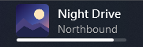

# Now Playing · Taskbar Widget

**See and control what’s playing from your Windows taskbar.** View album art,
seek through a track, and switch between a docked widget and a floating player.

**[Download the beta installer](https://github.com/BYxarek/now-playing-taskbar-widget/releases/download/v1.4.0.beta.2/SpotifyTaskbarWidget-Setup.exe)** ·
[Release notes](https://github.com/BYxarek/now-playing-taskbar-widget/releases/tag/v1.4.0.beta.2) ·
[Stable releases](https://github.com/BYxarek/now-playing-taskbar-widget/releases/latest)

Windows 10 (2004+) and Windows 11 · x64 · English, Português, Русский, Українська


| Floating player | Compact widget | Now-playing display |
| :---: | :---: | :---: |
|  |  |  |

## Install and get started

1. Run **SpotifyTaskbarWidget-Setup.exe** and choose an installation folder. The
   installer includes the .NET runtime and puts the widget and its dependencies
   in that folder.
2. Start playing something in Spotify, a browser, or another app that reports
   playback to Windows. The widget follows the active Windows media session
   with its default settings.
3. Right-click the widget to open its menu. Press **Caps Lock + S** to switch
   between the taskbar and the floating player. Change the shortcut from the
   notification-area icon.

The latest stable release uses a portable EXE. If you’re switching from a
portable build, close it before starting the installed widget.

## Make it yours

| What you can do | Where to find it |
| --- | --- |
| Play, pause, skip and seek | Use the widget buttons and click the progress bar to seek. |
| Move the widget | Enable **Move widget**, drag, then untick it to lock the position. In floating mode, hold the right mouse button and drag. |
| Show the widget on multiple screens | Select taskbars in **Monitor**. Enable the Windows taskbar on each screen you plan to use. |
| Change the layout | Adjust **Size**, **Brightness**, and **Buttons**. Hide the playback buttons for a track display, or enable **Shrink width to fit text** for a compact layout. |
| Use Spotify desktop controls | Show favorites, shuffle, Smart Shuffle, repeat, and Spotify’s own volume control when the desktop app exposes them. |
| Find more music | Use **Catalog search**, expand playlists, or open **My library** after connecting an account. |

The widget reduces its footprint on crowded taskbars and hides when there’s
too little space or a fullscreen app is active. Settings and the error log
are stored in `%APPDATA%\SpotifyTaskbarWidget\`.

## Updates

The installed widget checks this repository’s GitHub releases at startup and
once an hour. If an installer is available for a newer version, the right-click
menu shows it under **Updates**. Choose **Install and restart** to apply it.

- **Include prereleases** includes preview builds in update checks.
- **Install updates automatically** downloads and verifies the installer, updates
  the existing folder in the background, and restarts the widget.

Both options are off by default. If you installed this beta and want future
betas to appear, turn on **Include prereleases**.

## Spotify and SoundCloud catalogs

**Windows media** works without account credentials. Enable an optional catalog
to look up the current track’s link and cover art, search tracks and playlists,
and browse your personal library after connecting an account.

<details>
<summary><strong>Set up API access and playback</strong></summary>

Create an API app with the service you want to use. Add its Client ID and Client
Secret as Windows **user environment variables**, then restart the widget and
choose the service under **Track catalog**.

| Service | Environment variables | Account redirect URI |
| --- | --- | --- |
| [Spotify for Developers](https://developer.spotify.com/dashboard) | `SPOTIFY_CLIENT_ID`, `SPOTIFY_CLIENT_SECRET` | `http://127.0.0.1:43873/spotify/callback` |
| [SoundCloud for Developers](https://developers.soundcloud.com/docs/api/register-app) | `SOUNDCLOUD_CLIENT_ID`, `SOUNDCLOUD_CLIENT_SECRET` | `http://127.0.0.1:43873/soundcloud/callback` |

- **Spotify** sends playback and queue commands to your active Spotify Connect
  device. Start Spotify, select a device, and choose **Connect Spotify account**
  in the widget. Playback requires Premium. Development Mode restricts access
  to some playlist contents.
- **SoundCloud** plays public, fully streamable tracks in the widget and keeps a
  local queue for the current session. Connect your account to browse personal
  playlists and liked tracks.
- To connect an account, register the redirect URI from the table in the
  corresponding API app. The widget keeps the connection in memory until it
  exits or you disconnect.

[Catalog capabilities](docs/music-api-capabilities.md) · [Privacy policy](PRIVACY.md)

</details>

## Build from source

Install the [.NET 11 SDK](https://dotnet.microsoft.com/download/dotnet/11.0)
and [Inno Setup](https://jrsoftware.org/inno-setup/downloads). Publish to a fresh
`publish` directory, then build the installer.

```powershell
dotnet publish SpotifyTaskbarWidget.csproj -c Release --self-contained true -o publish
ISCC.exe setup.iss
```

The output is `installer/SpotifyTaskbarWidget-Setup.exe`. For a prerelease,
pass the same version to both commands, for example `-p:Version=1.4.0-beta.2`
and `/DMyAppVersion=1.4.0-beta.2`. Use the exact installer filename as the
GitHub release asset so the widget can find it.

## Help and credits

[Troubleshooting](TROUBLESHOOTING.md) ·
[Report a bug or request a feature](https://github.com/BYxarek/now-playing-taskbar-widget/issues) ·
[MIT license](LICENSE)

Maintained in the BYxarek fork. Based on the work of MechanicWB and
[Priler](https://github.com/Priler/now-playing-taskbar-widget). See the license
for attribution and trademark notices.
