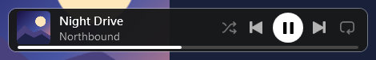
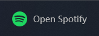

# Now Playing - Taskbar Widget

A now-playing widget embedded right into the Windows taskbar: album art, title
and artist of whatever's playing, with full controls — play/pause, skips and a
seekable progress bar. It follows any player through the Windows media session
(Spotify, YouTube in a browser, Apple Music, Windows Media Player, and more),
and for Spotify it adds the liked state, all three shuffle modes, repeat and
volume. Runs on Windows 10 and Windows 11.

> Independent project, **not affiliated
> with, sponsored or endorsed by Spotify AB**. "Spotify" is a trademark of
> Spotify AB.

## Player views

### Taskbar player


Spotify adds favorites, Smart Shuffle, repeat modes, and volume controls.


### Compact taskbar player


### Floating player



### Now-playing display


### Spotify launcher



## Install

- **GitHub Releases:** download and run
  [**SpotifyTaskbarWidget.exe**](https://github.com/BYxarek/now-playing-taskbar-widget/releases/latest).
  It is a portable, self-contained Windows x64 build: no installer or separate
  .NET installation is required.
- **Microsoft Store (recommended — always the latest version):**
  [**Now Playing - Taskbar Widget**](https://apps.microsoft.com/detail/9p12tljzg2cj) —
  one-click install, automatic updates, works with Smart App Control enabled,
  and supports both Windows 10 (2004+) and Windows 11.
- **winget** (pending review): `winget install MechanicWB.TaskbarWidgetForSpotify`
- UI languages: English, Portuguese, Russian and Ukrainian (follows your Windows
  language, or can be selected manually).

## How it works

- Track data comes from the **Windows media session API (SMTC)** — the same one
  behind the Windows volume flyout. Any player that reports to Windows shows up
  there (Spotify, YouTube, Apple Music, Windows Media Player…), so the widget
  follows the current media session. The default **Windows media** catalog
  mode requires no credentials.
- Selecting **Spotify** or **SoundCloud** as the track catalog searches that
  service for the title and artist reported by Windows. A match supplies a
  track link and, when available, cover art. Windows supplies the playback
  state and controls, and provides the cover if the catalog lookup fails.
- For Spotify's extra controls (liked state, Smart Shuffle, repeat, internal
  volume) there is no clean API, so the widget reads Spotify's own accessibility
  tree via UI Automation.
- The taskbar no longer supports "deskbands", so the widget is a borderless
  always-visible window docked over the empty area of the taskbar.
- **Automatic positioning:** it aligns itself next to the clock/weather area and
  never overlaps the app buttons or the system tray. The Windows 10 and 11
  taskbars are completely different internally (11 is XAML, 10 is classic child
  windows), so each has its own positioning logic. Works on any resolution/DPI,
  adapts to left-aligned taskbars, follows auto-hide, and supports multiple
  monitors.
- When the taskbar gets crowded, the widget narrows the text area and drops
  optional controls. It hides if its minimum layout cannot fit.
- Hides automatically when an app is fullscreen (games, videos).

## Usage

- **Floating player:** press `Caps Lock + S` to move the widget from the
  taskbar onto the screen; press it again to return. The shortcut can be changed
  from the tray menu. Floating mode adds a dark background and a visible border
  so the player stays readable over other windows.
- **Move the floating player:** hold the right mouse button anywhere on the
  player and drag it horizontally or vertically. Its position is saved for each
  monitor and restored the next time floating mode is opened. A normal right
  click without dragging uses the configured click action.
- **Open Spotify on right-click:** off by default. Enable this setting to
  open Spotify with the right button and the settings menu with the left button.
- **Position:** locked and automatic by default. To move it: right-click →
  *Move widget*, drag, and untick to lock it in the new spot. *Reset to
  automatic position* brings back auto alignment.
- **Track catalog:** open the widget menu → *Track catalog* and choose
  *Windows media*, *Spotify*, or *SoundCloud*. When a track matches the selected
  catalog, *Open track in …* opens the service's track page.
- **Playlists:** open *Spotify playlists* or *SoundCloud playlists* in the
  widget menu to search that catalog for public playlists using the current
  track's artist. Expand a result to see its tracks and choose *Show more*
  when another page is available. Expand a track and choose *Play* to start
  it or *Add to queue* to save it for later. SoundCloud plays public full-length
  streams in the widget. Spotify starts the track or playlist on your active
  Spotify Connect device. Spotify Development Mode restricts access to the
  contents of playlists you neither own nor collaborate on.
- **Catalog search:** enter a title or artist and choose *Find tracks* or
  *Find playlists*. Search results and playlist contents open in the menu.
- **My library:** after connecting the selected account, browse personal
  playlists and saved Spotify tracks or liked SoundCloud tracks. The library
  is read-only.
- **Multiple monitors:** right-click → *Monitor* and tick every taskbar you
  want a widget on — each display gets its own, with shared settings. (Needs
  Windows' "show my taskbar on all displays" enabled for secondary monitors.)
- **Size:** right-click → *Size* → Small / Normal / Large.
- **Brightness:** right-click → *Brightness* — a slider from 20% to 100%, handy
  to dim the widget on OLED or transparent taskbars. Scroll the mouse wheel
  over it to fine-tune.
- **Buttons:** right-click → *Buttons* to choose which controls appear —
  play/pause, favorites (+), shuffle, previous, next, repeat, volume. Hide
  play/pause to use it as a pure now-playing display.
- **Long titles:** scroll continuously by default; right-click → *Scroll title
  only once* to have them scroll once at the start of each track and then rest.
- **Favorites (+, Spotify):** reads and clicks Spotify's own button through the
  Spotify window's accessibility tree — shows a **green check** when the track
  is already saved, and adds it without stealing focus. Spotify freezes this
  info while its window is minimized (and has locked the Web API alternative),
  so the widget shows the green check only when it can actually confirm it,
  otherwise it stays neutral rather than guessing. See
  [TROUBLESHOOTING.md](TROUBLESHOOTING.md) for the full explanation.
- **Shuffle (Spotify):** all three modes — off (gray), shuffle (green) and
  **Smart Shuffle** (green with a star). Repeat supports off / playlist / track.
- **Volume:** for Spotify it moves Spotify's own slider; for other players it
  uses the Windows app volume.
- **Progress bar:** live position at the bottom of the widget; click to seek.
- Settings and error log live in `%APPDATA%\SpotifyTaskbarWidget\`.

### Spotify and SoundCloud API setup

Create your own API app and set the corresponding pair of **user environment
variables** in Windows. Use your API app's Client ID and Client Secret.

| Catalog | User environment variables | App registration |
| --- | --- | --- |
| Spotify | `SPOTIFY_CLIENT_ID`, `SPOTIFY_CLIENT_SECRET` | [Spotify for Developers](https://developer.spotify.com/dashboard), Premium required for Development Mode |
| SoundCloud | `SOUNDCLOUD_CLIENT_ID`, `SOUNDCLOUD_CLIENT_SECRET` | [SoundCloud Developers](https://developers.soundcloud.com/docs/api/register-app), Artist Pro required |

Restart the widget and select the catalog. The selected service receives the
search query for the current track. Choose **Windows media** to use local
metadata only. See the [privacy policy](PRIVACY.md).

#### Start playback from a playlist

- **Spotify:** register `http://127.0.0.1:43873/spotify/callback` as a redirect
  URI for the Spotify app you configured. Open Spotify and select a playback
  device. Choose **Connect Spotify account** in the widget menu, then
  authorize the account in your browser. A Premium account is required.
  The connection lasts until you exit the widget or choose **Disconnect
  Spotify account**. Use **Play playlist** to start a whole playlist, or click
  a track when Spotify provides the playlist contents.
- **SoundCloud:** click a public, fully streamable track. The widget handles
  play/pause and seeking where the stream allows it. Use **Stop SoundCloud
  playback** to stop and clear the queue. Use **SoundCloud queue** to start a
  waiting queue or skip to the next track. While the player is active, queued
  tracks advance automatically. The SoundCloud logo links to the track's
  source page.
- **SoundCloud library:** register `http://127.0.0.1:43873/soundcloud/callback`
  as the SoundCloud app's redirect URI. Select **Connect SoundCloud account**
  and authorize it in your browser. This is only needed for the private library.
  Both account connections last until you exit the widget or disconnect.

Spotify queue commands affect the active Spotify Connect device. The
SoundCloud queue is local to the running widget.

See [Music API capabilities](docs/music-api-capabilities.md) for potential
additions and their API requirements.

## Pro (optional)

The widget is free. An optional paid **Pro** add-on on the Microsoft Store adds
themes, an audio visualizer, synced lyrics and global hotkeys. The whole core
(now-playing, controls, positioning, any-player support, Windows 10 and 11)
stays free.

## Troubleshooting

Something not working? See **[TROUBLESHOOTING.md](TROUBLESHOOTING.md)** — covers
"nothing playing", antivirus flags, Smart App Control, positioning and more.
Still stuck?
[Open an issue](https://github.com/BYxarek/now-playing-taskbar-widget/issues).

## Support

Free and open source. If you find it useful, you can support development on
**[Ko-fi](https://ko-fi.com/mechanicwb2)** ☕

## Building

Requires the [.NET 11 SDK](https://dotnet.microsoft.com/download/dotnet/11.0).

```powershell
dotnet publish SpotifyTaskbarWidget.csproj -c Release --self-contained true -o publish
```

Produces a single standalone `SpotifyTaskbarWidget.exe` for Windows x64.
On first launch, it extracts the bundled .NET and WPF files to `%TEMP%\.net`.
To build the installer, run `ISCC.exe setup.iss` with Inno Setup 7 after publishing.
To build the Store package, run `Packaging/build-msix.ps1` from PowerShell.

## Structure

| File | Role |
|---|---|
| `MainWindow.xaml(.cs)` | Widget UI, positioning, responsive layout, menu |
| `MediaService.cs` | Windows media session (track, art, play/pause, timeline) |
| `SpotifyUiaService.cs` | Spotify window accessibility: favorites, shuffle, repeat, volume |
| `SpotifyVolume.cs` | CoreAudio: app volume / play state via the Windows mixer |
| `Interop.cs` | Win32 (taskbar position, topmost, fullscreen detection, input) |
| `WidgetSettings.cs` | Position, scale, theme and visible buttons, stored as JSON |
